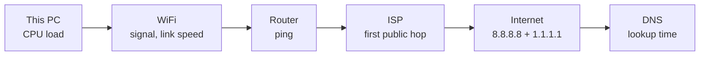
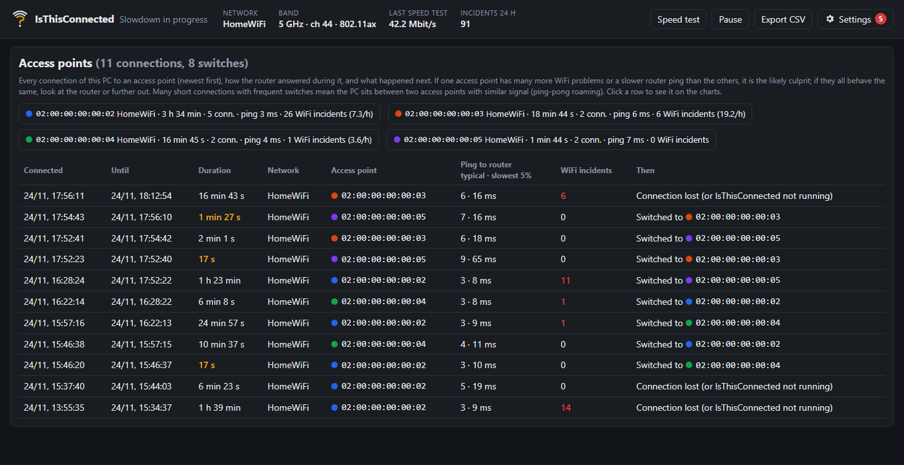
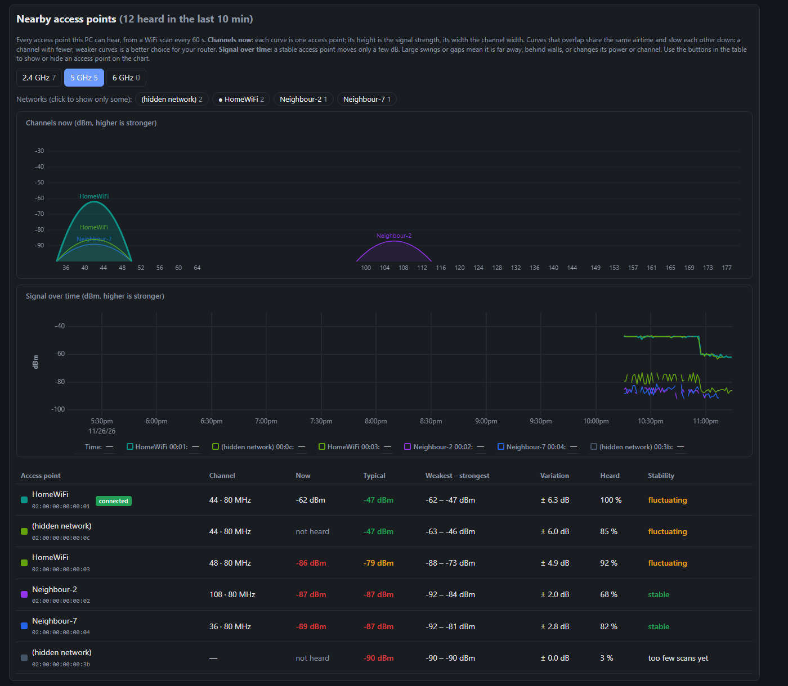

<p align="center">
  <picture>
    <source media="(prefers-color-scheme: dark)" srcset="docs/logo-dark.svg">
    
  </picture>
</p>

<h1 align="center">IsThisConnected</h1>

<p align="center"><em>Say it out loud: "is disconnected". The question you ask when the network acts up, and the tool that answers it.</em></p>

[](https://github.com/martiro/IsThisConnected/actions/workflows/ci.yml)
[](https://github.com/martiro/IsThisConnected/releases/latest)
-0078D6)


**A lightweight, always-on WiFi and Internet monitor that tells you *where* a problem is:
your PC, the WiFi signal, the access point, the router, your ISP, or the Internet beyond it.**

One small executable sits in the system tray, measures your connection every second, keeps the history,
and automatically records every slowdown and disconnection together with the metric that caught it,
the likely cause, and a plain-English explanation.

Built and tested on **Windows 10/11**. **Linux and macOS builds are experimental**: see [Platforms](#platforms).


## Why

Most network tools either show you a number *right now* (a speed test, a ping) or draw a graph you
cannot go back in time with. When your video call froze yesterday at 15:42 they cannot tell you why.
And a single "ping 8.8.8.8" only tells you that *something* is wrong, not *what*.

IsThisConnected measures every link of the chain separately and keeps doing it in the background, so when
something goes wrong you can see exactly when, for how long, and where it started.

## How it finds the problem



A problem affects every link *after* the one where it starts. A slow router makes the Internet
slow too, but not the other way round. So **the first red link from the left is where to look**.
The dashboard shows this chain live, and every incident is labelled with *where* it happened:

| Where | What IsThisConnected saw |
|---|---|
| **Your PC** | CPU saturated for 10 s+ while the network got slow, or the operating system itself dropped the WiFi (sleep, standby) |
| **WiFi signal** | The router answered slowly *and* the signal dropped by 10 dB or more |
| **WiFi link** | Negotiated link speed collapsed, or the PC was switching access point |
| **Access point / router** | The router answered slowly while the signal was stable: congestion or interference |
| **Router / LAN** | Same, but the PC is on a cable, so WiFi is ruled out |
| **ISP / your line** | Router fine, but the ISP's first router *and* the Internet were slow |
| **Internet (beyond ISP)** | Router and ISP fine, both Internet servers slow |
| **DNS server** | Pings fine, name resolution slow or failing |
| **Single remote server** | Only one of the two Internet test servers was slow: not your connection |

Signal strength (RSSI) never raises an alarm on its own, because its absolute value differs between
drivers. It is only used to confirm a slow router.

## Features

- **Measures everything at once**:
  - ping, packet loss and jitter to the router, the ISP and two Internet servers (every second);
  - DNS lookup time and TCP connect time (every 10 s);
  - WiFi signal, link speed, channel and band;
  - traffic on the active adapter;
  - CPU load;
  - a periodic download test.
- **Automatic incident log**: an incident opens after 5 s of bad values and closes after 15 s of good ones, so short blips don't flood the log. Each incident records:
  - type (slowdown or disconnection) and duration;
  - the metric that triggered it and its peak value;
  - where the problem was, with an explanation;
  - the disconnect reason logged by the operating system (Windows; Linux with wpa_supplicant);
  - a snapshot of all metrics at that moment.
- **History you can browse**:
  - per-second data for 7 days, per-minute averages for a year;
  - presets (15 min to 30 days), custom date ranges, drag-to-zoom and keyboard/mouse-wheel panning;
  - synchronised charts with incidents drawn as coloured bands;
  - CSV export.
- **Access point comparison**: every connection to every access point with date and time, how long it lasted, the router ping during it, the WiFi incidents, and where the PC went next. It reveals a bad access point, or *ping-pong roaming* between two of them.
- **Nearby access points** (Windows): a WiFi scan every 60 s lists every access point the PC can hear. A channel view per band (2.4 / 5 / 6 GHz) draws each one as a curve as wide as its channel (20 to 160 MHz) and as high as its signal, so crowded channels stand out. A chart shows each signal over time, and a table rates its stability over the selected range: typical signal, weakest to strongest, variation (± dB), and how often it was heard. A network filter on top keeps only the networks you care about in all three.
- **Threshold tuning that shows its effect**: the ⚙ Settings panel shows, for each threshold:
  - the range of a good connection;
  - your own typical values;
  - how often you were beyond the threshold, updated as you type;
  - how many incidents it opened.

  It also tells *false alarms* (threshold stricter than a healthy connection) apart from *real problems*.
- **Tray icon and browser tab**: the question mark in the logo shows the status. It matches the waves when all is
  well, turns amber on a slowdown, red on a disconnection and grey while paused. Hover the tray icon for the current values;
  an optional desktop notification appears when an incident starts.
- **Metered connections**: detects metered networks and skips the automatic download test on them.
- **Light enough to forget**: about 30–45 MB of RAM (the upper end right after browsing long ranges in the dashboard) and about 0.5% of one CPU core, measured on the author's laptop.

### Incidents explained in plain English


### Access points and roaming



### Nearby access points: channels and signal stability

The *Nearby access points* section, at the bottom of the dashboard, shows every access point the PC can hear,
not only the one it is connected to. It answers two questions: *is my channel crowded?* and *is the signal steady?*



- **Band and networks**: pick the band (2.4, 5 or 6 GHz; the number is how many access points were heard there),
  then click the networks you want to see. With no network selected, all of them are shown; with some selected,
  every view below shows only those. The network you are connected to is marked with ●, and the choice is remembered
  in your browser. *Show all* clears it.
- **Channels now**: the classic channel view. Each access point is a curve centred on the channels it occupies, as
  wide as its channel (20, 40, 80 or 160 MHz) and as high as its signal. Your access point is drawn thicker. Curves
  that overlap share the same airtime and slow each other down, so a channel with fewer and weaker curves is a better
  choice for your router.
- **Signal over time**: each access point's signal over the selected time range, on the same time axis as the other
  charts (drag to zoom works here too). A gap means the access point was not heard in that scan. To keep the chart
  readable it starts with the 8 strongest plus the one you are connected to; the buttons in the table add or remove one.
- **Stability table**, over the selected time range:

  | Column | Meaning |
  |---|---|
  | Now | signal in the last scan, or *not heard* if it was missed in the last two scans |
  | Typical | median signal; green from −60 dBm, amber below −70, red below −80 |
  | Weakest – strongest | the range it moved in |
  | Variation | standard deviation, in dB |
  | Heard | share of scans that picked it up |
  | Stability | *very stable* (under 2 dB), *stable* (under 4), *fluctuating* (under 7), *unstable*; *heard only now and then* if heard in less than half of the scans |

  A healthy, nearby access point moves only a few dB. Large swings or frequent gaps mean it is far away, behind
  walls, or that it changes its power or channel. Per-second data is kept for 7 days; over longer ranges the
  table works on per-minute averages, which make the variation look smaller.

### Settings: find the false alarms


## Platforms

| Feature | Windows 10/11 | Linux | macOS |
|---|:---:|:---:|:---:|
| **Status** | ✅ tested on real hardware | 🧪 experimental | 🧪 experimental |
| Builds and passes the automated tests on GitHub's machines | ✅ | ✅ | ✅ |
| Ping, packet loss, jitter (router, Internet) | ✅ | ✅ ¹ | ✅ |
| ISP first hop (light traceroute) | ✅ | ✅ ¹ | ⚠️ may not be found |
| DNS and TCP timing, download test | ✅ | ✅ | ✅ |
| Adapter traffic, CPU load | ✅ | ✅ | ✅ |
| WiFi signal, link speed, channel, band | ✅ | ✅ (nl80211) | ✅ (CoreWLAN, transmit rate only) |
| Network name and access point (BSSID): AP comparison, roaming | ✅ | ✅ | ❌ hidden by macOS ² |
| Nearby access points: channels, signal stability | ✅ ⁵ | ❌ | ❌ |
| Why the WiFi dropped (OS disconnect reason) | ✅ | ⚠️ with wpa_supplicant ³ | ❌ |
| Metered connection detection | ✅ | ✅ (NetworkManager) | ❌ |
| Tray icon | ✅ | ⚠️ needs a StatusNotifier/AppIndicator tray ⁴ | ✅ |
| Desktop notifications | ✅ | ✅ | ✅ |
| Start at sign-in | ✅ | ✅ (XDG autostart) | ✅ (LaunchAgent) |

¹ Uses unprivileged "ping sockets", allowed when `net.ipv4.ping_group_range` includes your group: the default on most
current systemd-based distributions. If it is not, IsThisConnected tells you, and
`sudo sysctl -w net.ipv4.ping_group_range="0 2147483647"` enables it.
² Since macOS 14 the network name and BSSID are only given to apps the user allowed to use Location, and a plain
executable cannot ask for it. Everything else works, but the access point comparison and roaming detection don't.
³ Read from the system journal (`CTRL-EVENT-DISCONNECTED` lines), which your user must be allowed to read:
true for the first user on most desktops. Not available with iwd.
⁴ KDE, Xfce, Cinnamon and others have one; on GNOME install the *AppIndicator and KStatusNotifierItem* extension.
The icon is drawn for a dark panel (the common default), because there is no standard way to ask the desktop
for its panel color. The dashboard works either way.
⁵ Windows 11 only allows it with *Settings › Privacy & security › Location › Let desktop apps access your location*
turned on; the dashboard tells you when Windows blocks the scan.

> [!WARNING]
> **Linux and macOS support is experimental and has not been tested on a real WiFi connection yet.**
> It compiles and passes the automated tests on GitHub's Linux and macOS machines, which run the native
> calls they can (ping, routing, adapter counters, CPU) but have no WiFi adapter. If you try it, please
> [tell us how it went](#help-wanted-linux-and-macos-testers): every report helps, and contributions are very welcome.

## Getting started

1. Download the file for your system from the [latest release](https://github.com/martiro/IsThisConnected/releases/latest).
   It is built from this source by GitHub Actions and can be [verified](#verifying-downloads). You can also [build it yourself](#building-from-source).

   | System | File |
   |---|---|
   | Windows 10/11 | `isthisconnected.exe` |
   | Linux (x86-64 / ARM64) | `isthisconnected-linux-amd64` / `isthisconnected-linux-arm64` |
   | macOS (Apple Silicon / Intel) | `isthisconnected-macos-arm64` / `isthisconnected-macos-amd64` |

2. Run it. An icon appears in the tray and the dashboard opens at <http://127.0.0.1:8777>.
   - **Linux**: `chmod +x isthisconnected-linux-amd64 && ./isthisconnected-linux-amd64`
   - **macOS**: the build is not signed by Apple, so remove the download quarantine first:
     `xattr -d com.apple.quarantine isthisconnected-macos-arm64 && chmod +x isthisconnected-macos-arm64`
3. Optional: start it automatically when you sign in.

```
isthisconnected              start (tray icon + dashboard)
isthisconnected install      start automatically at sign-in (per-user, no admin rights needed)
isthisconnected uninstall    remove automatic start
isthisconnected open         open the dashboard
```

Running it a second time just opens the dashboard: only one instance runs.
No administrator or root rights are needed for anything.

## Verifying downloads

You don't have to trust the release files: you can check them. These three checks go from quickest to strongest:

1. **Checksum**: the file was not altered after it was published. Compare its SHA-256 with the line in `SHA256SUMS`:
   ```
   Get-FileHash isthisconnected.exe                 # Windows (PowerShell)
   sha256sum -c SHA256SUMS --ignore-missing         # Linux
   shasum -a 256 -c SHA256SUMS --ignore-missing     # macOS
   ```
2. **Build provenance**: the file was built by this repository's release workflow from a specific commit, not
   uploaded by hand. Every file has an attestation signed through [Sigstore](https://www.sigstore.dev/) and recorded
   in its public transparency log. Verify it with the [GitHub CLI](https://cli.github.com/), available for releases from v1.2.0 on:
   ```
   gh attestation verify isthisconnected.exe --repo martiro/IsThisConnected
   ```
3. **Rebuild it yourself** (Windows and Linux builds): they are reproducible, so compiling the same tag with the Go
   version from `go.mod` gives a byte-identical file. Use the tag of the release you downloaded, then compare the two hashes:
   ```
   git clone --branch v1.1.0 https://github.com/martiro/IsThisConnected.git   # the release tag to check
   cd IsThisConnected
   export GOTOOLCHAIN=go1.27.4 CGO_ENABLED=0                    # PowerShell: $env:GOTOOLCHAIN="go1.27.4"; $env:CGO_ENABLED="0"
   GOOS=windows GOARCH=amd64 go build -trimpath -ldflags "-H windowsgui -s -w" -o isthisconnected.exe .
   GOOS=linux GOARCH=amd64 go build -trimpath -ldflags "-s -w" -o isthisconnected-linux-amd64 .
   ```
   The release workflow does the same on every release, rebuilding on a different operating system, and fails
   if a file is not identical. macOS builds go through Apple's C compiler and are not reproducible.

These checks prove that a file contains exactly the public source code and nothing else. What that code does
is open for anyone to read. Security problems can be reported privately: see [SECURITY.md](SECURITY.md).

## Configuration

Use the **⚙ Settings** button in the dashboard. Changes apply immediately and are saved to `config.json`
in the data folder (see below). That file also holds the options that need a restart:
- the Internet test targets;
- the speed test URL and interval;
- notifications on/off;
- `scan_interval_sec` (default 60): how often to scan nearby access points. While connected, each scan takes the radio off its channel for a moment, so the router ping can show a short spike. Set it to `0` to record only the scans Windows does by itself.

## Data and privacy

- Everything stays on your computer, in a SQLite database with the config and the logs. There is no account, no telemetry and no cloud.
  - Windows: `%LOCALAPPDATA%\IsThisConnected\`
  - Linux: `~/.local/share/IsThisConnected/` (or `$XDG_DATA_HOME`)
  - macOS: `~/Library/Application Support/IsThisConnected/`
- The dashboard listens on `127.0.0.1` only and rejects requests for any other host name, which guards against DNS rebinding.
- Network traffic IsThisConnected generates:
  - ICMP pings to your router, your ISP's first hop, `8.8.8.8` and `1.1.1.1`;
  - DNS lookups of random names under `example.com`;
  - a TCP connection to `1.1.1.1:443`;
  - a light traceroute every 10 minutes;
  - a WiFi scan every 60 s (Windows). It only listens to what access points broadcast, but it does store the names
    (SSID), hardware addresses (BSSID) and signal of your neighbours' networks in the local database, and they appear
    in the CSV export as `scan/<band>/<bssid>/<network>`.
- The download test fetches **10 MB from `speed.cloudflare.com` every 15 minutes, about 1 GB per day**. It is skipped on metered connections and while you are already using the network heavily. You can change the interval in `config.json`.

## Building from source

Requirements: Go 1.27 or newer. Windows and Linux need no C compiler. macOS needs the Xcode command line tools
(`xcode-select --install`), because CoreWLAN and the tray are reached through cgo.

Install straight from GitHub:

```
go install -ldflags "-H windowsgui" github.com/martiro/IsThisConnected@latest   # Windows: no console window
go install github.com/martiro/IsThisConnected@latest                            # Linux, macOS
```

Or clone and build:

```
git clone https://github.com/martiro/IsThisConnected.git
cd IsThisConnected
go test -short ./...                              # logic tests + basic native calls (no WiFi needed)
go test ./...                                     # also checks WiFi, metered flag and disconnect reason on this machine
go build -ldflags "-H windowsgui -s -w" -o isthisconnected.exe .    # Windows
go build -ldflags "-s -w" -o isthisconnected .                      # Linux, macOS
```

Every push is checked by GitHub Actions on Windows, Linux and macOS: gofmt, `go vet`, `govulncheck`, tests and build.
Pushing a tag such as `v1.2.0` builds all the executables, checks that the Windows and Linux ones are reproducible,
signs their provenance and publishes them as a release (see [Verifying downloads](#verifying-downloads)).
To try the release workflow without publishing anything, run it by hand: *Actions → Release → Run workflow*
(builds and checks everything, then stops before signing and publishing).

The dashboard (HTML/JS/CSS plus [uPlot](https://github.com/leeoniya/uPlot)) is embedded in the
executable: no CDN and no internet access are needed to view it.

| File | What it does |
|---|---|
| `platform.go` | What each platform provides, shared helpers |
| `platform_windows.go`, `metered_windows.go`, `eventlog*.go`, `autostart_windows.go` | Windows: ICMP with TTL, routing, adapter counters, WLAN API, CPU, metered flag (COM), event log, toasts, Run key |
| `platform_linux.go`, `icmp_linux.go` | Linux: /proc and /sys, nl80211, NetworkManager, journal, notifications, XDG autostart |
| `platform_darwin.go`, `icmp_darwin.go` | macOS: CoreWLAN, routing socket, getifaddrs, Mach CPU stats, LaunchAgent |
| `icmp_unix.go`, `platform_unix.go`, `native_parse.go` | Linux and macOS: ping sockets, single instance, pure parsers (tested on every OS) |
| `detect.go` | Pure logic: statistics, hysteresis, diagnosis, "where" explanations |
| `monitor.go`, `app.go` | Collectors and the once-a-second evaluation |
| `store.go` | SQLite storage, aggregation, retention, access point sessions |
| `server.go` | Local HTTP API and live stream (server-sent events) |
| `tray.go`, `main.go` | Tray icon, autostart, single instance |
| `logo.go`, `assets/logo.json` | The logo, drawn at any size for the tray: the question mark takes the status color |
| `assets/icon.png`, `rsrc_windows_amd64.syso` | Windows executable icon. Regenerate after changing the PNG: `go run github.com/tc-hib/go-winres@v0.3.3 simply --arch amd64 --manifest none --icon assets/icon.png` |
| `web/` | Dashboard |
| `.github/` | CI and release workflows (actions pinned by commit hash), Dependabot |

## Limitations

- The nearby access point scan is Windows only. On Windows 11 it needs *Settings › Privacy & security › Location › Let desktop apps access your location*; the dashboard says so when Windows blocks it.
- IPv4 only. Linux and macOS: see [Platforms](#platforms) for what is missing.
- Telling the access point from the router relies on comparing access points. With a single access point (typical at home, where the router *is* the access point), IsThisConnected tells you so and suggests using a cable for a while to settle it.
- Many ISP routers answer ping with low priority, so the ISP link refines a diagnosis but never opens an incident on its own.
- The disconnect reason "disconnected by the driver" doesn't say whether the adapter or the access point gave up. IsThisConnected reports it as "WiFi adapter or access point".

## Help wanted: Linux and macOS testers

The Linux and macOS versions have only run on GitHub's build machines, which have no WiFi. If you have a
Linux or macOS laptop, you can help a lot in two minutes:

1. Run the self-check (needs [Go](https://go.dev/dl/); on macOS also `xcode-select --install`):
   ```
   git clone https://github.com/martiro/IsThisConnected.git
   cd IsThisConnected
   go test -v -run 'TestNativeAPIs|TestPlatformBasics' ./...
   ```
2. [Open an issue](https://github.com/martiro/IsThisConnected/issues/new) with the output, your distribution or
   macOS version, and your WiFi adapter if you know it. Feel free to hide your network name and BSSIDs.
3. Even better, leave it running for a while and tell us whether the dashboard values (signal, link speed,
   router and ISP ping) and the incident explanations look right.

Pull requests are welcome, from small fixes to a proper macOS app bundle, which would bring back the
network name and BSSID.

## License

[MIT](LICENSE)
