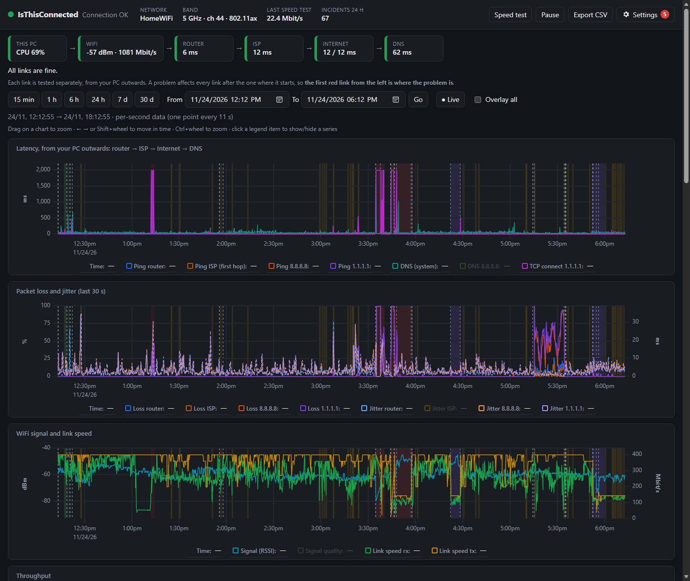
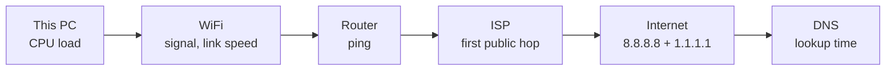
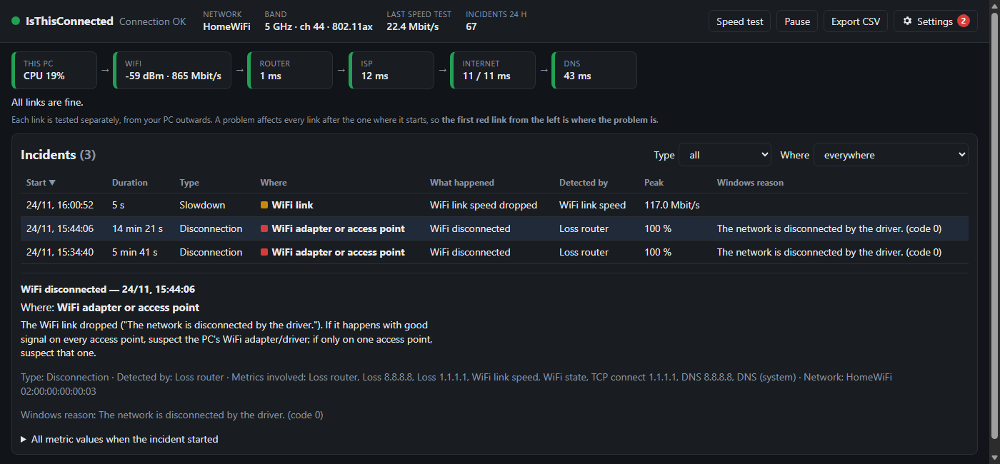
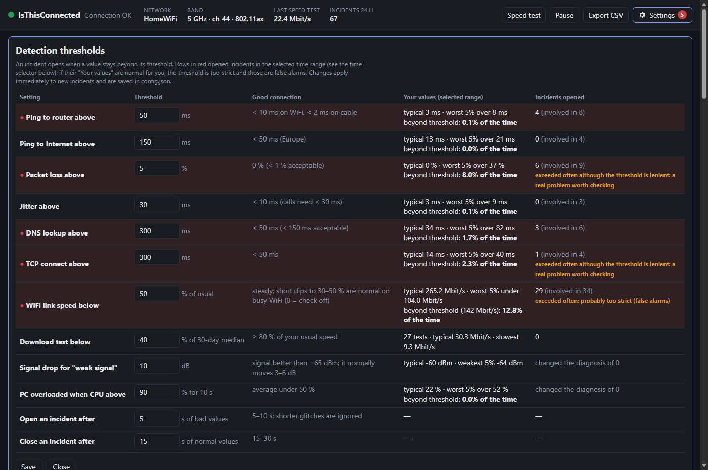

# IsThisConnected

*Say it out loud: "is disconnected". The question you ask when the network acts up, and the tool that answers it.*

[](https://github.com/martiro/IsThisConnected/actions/workflows/ci.yml)
[](https://github.com/martiro/IsThisConnected/releases/latest)


**A lightweight, always-on WiFi and Internet monitor for Windows that tells you *where* a problem is:
your PC, the WiFi signal, the access point, the router, your ISP, or the Internet beyond it.**

One small `.exe` sits in the system tray, measures your connection every second, keeps the history,
and automatically records every slowdown and disconnection together with the metric that caught it,
the likely cause, and a plain-English explanation.



## Why

Most network tools either show you a number *right now* (a speed test, a ping) or draw a graph you
cannot go back in time with. When your video call froze yesterday at 15:42 they cannot tell you why.
And a single "ping 8.8.8.8" only tells you that *something* is wrong, not *what*.

IsThisConnected measures every link of the chain separately and keeps doing it in the background, so when
something goes wrong you can see exactly when, for how long, and where it started.

## How it finds the problem



A problem affects every link *after* the one where it starts. A slow router makes the Internet
slow too, but not the other way round. So **the first red link from the left is where to look**.
The dashboard shows this chain live, and every incident is labelled with *where* it happened:

| Where | What IsThisConnected saw |
|---|---|
| **Your PC** | CPU saturated for 10 s+ while the network got slow, or Windows itself dropped the WiFi (sleep, standby) |
| **WiFi signal** | The router answered slowly *and* the signal dropped by 10 dB or more |
| **WiFi link** | Negotiated link speed collapsed, or the PC was switching access point |
| **Access point / router** | The router answered slowly while the signal was stable: congestion or interference |
| **Router / LAN** | Same, but the PC is on a cable, so WiFi is ruled out |
| **ISP / your line** | Router fine, but the ISP's first router *and* the Internet were slow |
| **Internet (beyond ISP)** | Router and ISP fine, both Internet servers slow |
| **DNS server** | Pings fine, name resolution slow or failing |
| **Single remote server** | Only one of the two Internet test servers was slow: not your connection |

Signal strength (RSSI) never raises an alarm on its own, because its absolute value differs between
drivers. It is only used to confirm a slow router.

## Features

- **Measures everything at once**:
  - ping, packet loss and jitter to the router, the ISP and two Internet servers (every second);
  - DNS lookup time and TCP connect time (every 10 s);
  - WiFi signal, link speed, channel and band;
  - traffic on the active adapter;
  - CPU load;
  - a periodic download test.
- **Automatic incident log**: an incident opens after 5 s of bad values and closes after 15 s of good ones, so short blips don't flood the log. Each incident records:
  - type (slowdown or disconnection) and duration;
  - the metric that triggered it and its peak value;
  - where the problem was, with an explanation;
  - the disconnect reason that Windows logged;
  - a snapshot of all metrics at that moment.
- **History you can browse**:
  - per-second data for 7 days, per-minute averages for a year;
  - presets (15 min to 30 days), custom date ranges, drag-to-zoom and keyboard/mouse-wheel panning;
  - synchronised charts with incidents drawn as coloured bands;
  - CSV export.
- **Access point comparison**: every connection to every access point with date and time, how long it lasted, the router ping during it, the WiFi incidents, and where the PC went next. It reveals a bad access point, or *ping-pong roaming* between two of them.
- **Threshold tuning that shows its effect**: the ⚙ Settings panel shows, for each threshold:
  - the range of a good connection;
  - your own typical values;
  - how often you were beyond the threshold, updated as you type;
  - how many incidents it opened.

  It also tells *false alarms* (threshold stricter than a healthy connection) apart from *real problems*.
- **Tray icon**: green / yellow / red / grey for OK / slowdown / disconnection / paused, a tooltip with the current values, and an optional Windows notification when an incident starts.
- **Metered connections**: detects metered networks and skips the automatic download test on them.
- **Light enough to forget**: about 30–45 MB of RAM (the upper end right after browsing long ranges in the dashboard) and about 0.5% of one CPU core, measured on the author's laptop.

### Incidents explained in plain English



### Access points and roaming


### Settings: find the false alarms



## Getting started

1. Download `isthisconnected.exe` from the [latest release](https://github.com/martiro/IsThisConnected/releases/latest). It is built from this source by GitHub Actions, and a `.sha256` file is published next to it. You can also [build it yourself](#building-from-source).
2. Run it. An icon appears in the tray and the dashboard opens at <http://127.0.0.1:8777>.
3. Optional: start it automatically when you sign in.

```
isthisconnected.exe              start (tray icon + dashboard)
isthisconnected.exe install      start automatically at sign-in (per-user, no admin rights needed)
isthisconnected.exe uninstall    remove automatic start
isthisconnected.exe open         open the dashboard
```

Running it a second time just opens the dashboard: only one instance runs.
No administrator rights are needed for anything.

## Configuration

Use the **⚙ Settings** button in the dashboard. Changes apply immediately and are saved to
`%LOCALAPPDATA%\IsThisConnected\config.json`. That file also holds the options that need a restart:
- the Internet test targets;
- the speed test URL and interval;
- notifications on/off.

## Data and privacy

- Everything stays on your PC, in `%LOCALAPPDATA%\IsThisConnected\`: a SQLite database, the config and the logs. There is no account, no telemetry and no cloud.
- The dashboard listens on `127.0.0.1` only and rejects requests for any other host name, which guards against DNS rebinding.
- Network traffic IsThisConnected generates:
  - ICMP pings to your router, your ISP's first hop, `8.8.8.8` and `1.1.1.1`;
  - DNS lookups of random names under `example.com`;
  - a TCP connection to `1.1.1.1:443`;
  - a light traceroute every 10 minutes.
- The download test fetches **10 MB from `speed.cloudflare.com` every 15 minutes, about 1 GB per day**. It is skipped on metered connections and while you are already using the network heavily. You can change the interval in `config.json`.

## Building from source

Requirements: Go 1.27 or newer, Windows. No CGO and no C compiler.

Install straight from GitHub. The `-H windowsgui` flag keeps a console window from opening:

```
go install -ldflags "-H windowsgui" github.com/martiro/IsThisConnected@latest
```

Or clone and build:

```
git clone https://github.com/martiro/IsThisConnected.git
cd IsThisConnected
go test -short ./...                              # logic tests (no Windows APIs)
go test ./...                                     # also checks the native Windows calls on this machine
go build -ldflags "-H windowsgui -s -w" -o isthisconnected.exe .
```

Every push is checked by GitHub Actions: gofmt, `go vet`, tests and build. Pushing a tag such as
`v1.0.0` builds the executable and publishes it as a release.

The dashboard (HTML/JS/CSS plus [uPlot](https://github.com/leeoniya/uPlot)) is embedded in the
executable: no CDN and no internet access are needed to view it.

| File | What it does |
|---|---|
| `win.go` | Native calls: ICMP with TTL (ping and traceroute), routing, adapter counters, WLAN API, CPU time |
| `metered.go` | Metered-connection check (`INetworkCostManager`, COM) |
| `eventlog.go` | WLAN disconnect reasons from the Windows event log, toast notifications |
| `detect.go` | Pure logic: statistics, hysteresis, diagnosis, "where" explanations |
| `monitor.go`, `app.go` | Collectors and the once-a-second evaluation |
| `store.go` | SQLite storage, aggregation, retention, access point sessions |
| `server.go` | Local HTTP API and live stream (server-sent events) |
| `tray.go`, `main.go` | Tray icon, autostart, single instance |
| `web/` | Dashboard |

## Limitations

- Windows 10/11 only, IPv4 only.
- Telling the access point from the router relies on comparing access points. With a single access point (typical at home, where the router *is* the access point), IsThisConnected tells you so and suggests using a cable for a while to settle it.
- Many ISP routers answer ping with low priority, so the ISP link refines a diagnosis but never opens an incident on its own.
- The disconnect reason "disconnected by the driver" doesn't say whether the adapter or the access point gave up. IsThisConnected reports it as "WiFi adapter or access point".

## License

[MIT](LICENSE)
